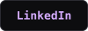

<div align="center">



**Real-time embedded systems. Timing is the specification, not an afterthought.**

Computer Engineering @ University of Florida · Gainesville, FL · looking for a Summer 2027 internship or research position

[](https://shivin.me) <a href="https://www.linkedin.com/in/shivinranand/"></a> <a href="mailto:shivin.r.anand@gmail.com"></a> <a href="https://shivin.me/ShivinAnandResume.pdf"></a>

</div>

## Award-winning builds

<table>
<tr>
<td width="50%" valign="top">

### 🏆 Re:Collection
**1st place, Meta track · Cal Hacks 13.0**

A family films a visit on a LiDAR iPhone. Re:Collection rebuilds it as a 3D room that a person living with Alzheimer's can walk back into, with an AI guide that narrates only what the recording shows and tracks which details they hold onto.

`Convex` `Claude` `Cartesia` `Moss` `three.js` `LiDAR`

[Case study](https://shivin.me/re-collection.html) · [Demo site](https://shividoge.github.io/re-collection-site/) · [Code](https://github.com/shividoge/re-collection)

</td>
<td width="50%" valign="top">

### 🏆 Deja View
**Best Use of AI/ML + DeepSpace award · SwampHacks XII**

Turns photos and phone clips of a real place into a 3D world you can walk through in a browser, a headset, or Roblox. 10 worlds rebuilt, the largest from 844,875 Gaussian splats.

`three.js` `Gaussian splats` `COLMAP` `Depth Anything V2` `WebXR` `Roblox`

[Case study](https://shivin.me/deja-view.html) · [Walk in: deja-view.photo](https://deja-view.photo)

</td>
</tr>
</table>

## Hardware and silicon

```text
$ cat now.txt
[RTL ] CPU in Verilog/SystemVerilog, Smart Systems Lab @ UF     ALU in progress
[PCB ] sole electrical designer, UF IEEE SoutheastCon robot     KiCad
[GOAL] CPU as the base for a quantized NN inference accelerator
```

| Project | What it is | Stack |
| --- | --- | --- |
| [**Hydroponic growth chamber**](https://shividoge.github.io/hydroponics-growth-system/) | Closed-loop grow chamber. NASA Kennedy Space Center award (2026). Plant mass from video at 6.9% mean error over 6 trials. | Embedded C |
| [**Biomass predictor**](https://github.com/shividoge/plant_growth_webapp_v2) | Non-destructive fresh biomass estimates from top-down video and images. | Python, FastAPI, OpenCV, scikit-learn, Next.js |
| **Monitoring PCB** | Logs CO₂, VOCs, temperature and humidity on four channels. | KiCad, BME680, I²C, 3.3 V |
| **S³ smart glasses** | AR glasses at 87 g and about $83 in parts, under a $150 cap. 1.3 s AI answer on the lens. | Embedded, hardware |
| [**Echo Sight**](https://github.com/shividoge/echo-sight) | See a room by listening to chirp echoes. Cal Hacks 13.0. | Audio, web |

More at **[shivin.me](https://shivin.me)**.

## Toolbox

         

I²C sensor integration · hardware bring-up and debugging

## Record

- **Undergraduate Research Assistant**, Smart Systems Lab, UF (2026–present)
- **Hardware Team**, IEEE Student Branch at UF: sole PCB designer on a ten-person team (2026–present)
- **Head Researcher**, USF Bio-Organic Electronics Lab
- **President**, Middleton Robotics: grew the program from 20 to 100+ members across nine teams, through to the World Championship (Rising All-Star Award)
- **Region 4a Coordinator & Webmaster**, FLSAM: site rebuild cut manual communication overhead by 60%

<div align="center"><sub><code>&gt; timing is the specification</code></sub></div>
