

<a href="https://shivin.me"><picture><source media="(prefers-color-scheme: light)" srcset="assets/light/banner.svg">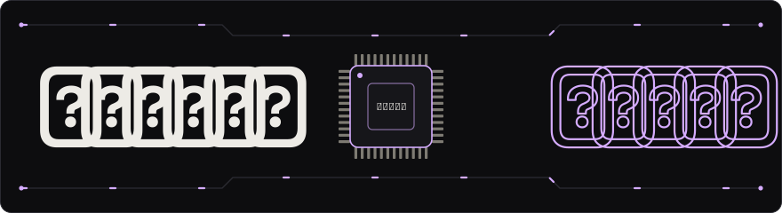</picture></a>

 <picture><source media="(prefers-color-scheme: light)" srcset="assets/light/subtitle.svg">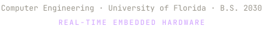</picture>

I build real-time embedded hardware, from CPU RTL in a research lab to the board for a competition robot. Open to an internship or research role for Summer 2027.

<picture><source media="(prefers-color-scheme: light)" srcset="assets/light/label-working-on.svg">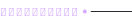</picture> 
<a href="https://shivin.me/fpga-cpu.html"><picture><source media="(prefers-color-scheme: light)" srcset="assets/light/working.svg">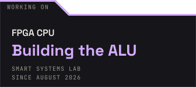</picture></a> <a href="https://shivin.me/fpga-cpu.html"><picture><source media="(prefers-color-scheme: light)" srcset="assets/light/datapath.svg">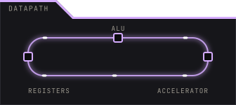</picture></a>

 <picture><source media="(prefers-color-scheme: light)" srcset="assets/light/label-projects.svg">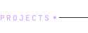</picture> 
<a href="https://shivin.me/fpga-cpu.html"><picture><source media="(prefers-color-scheme: light)" srcset="assets/light/card-fpga-cpu.svg">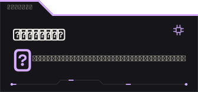</picture></a> 
<a href="https://shivin.me/robot-pcb.html"><picture><source media="(prefers-color-scheme: light)" srcset="assets/light/card-robot-pcb.svg">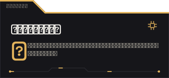</picture></a> 
<a href="https://shivin.me/environmental-pcb.html"><picture><source media="(prefers-color-scheme: light)" srcset="assets/light/card-monitoring-pcb.svg">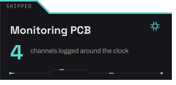</picture></a> 
<a href="https://shivin.me/middleton-robotics.html"><picture><source media="(prefers-color-scheme: light)" srcset="assets/light/card-middleton-robotics.svg">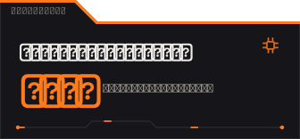</picture></a> 
<a href="https://shivin.me/flsam.html"><picture><source media="(prefers-color-scheme: light)" srcset="assets/light/card-flsam.svg">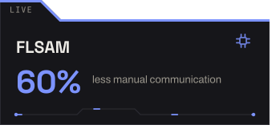</picture></a> 
<a href="https://shivin.me/hydroponic-chamber.html"><picture><source media="(prefers-color-scheme: light)" srcset="assets/light/card-growth-chamber.svg">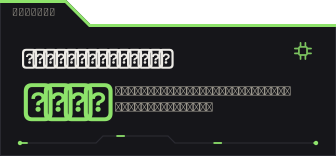</picture></a> 
<a href="https://shivin.me/smart-glasses.html"><picture><source media="(prefers-color-scheme: light)" srcset="assets/light/card-s3-glasses.svg">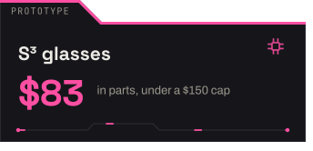</picture></a> 
<a href="https://shivin.me/deja-view.html"><picture><source media="(prefers-color-scheme: light)" srcset="assets/light/card-deja-view.svg">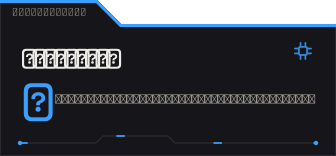</picture></a> 
<a href="https://shivin.me/re-collection.html"><picture><source media="(prefers-color-scheme: light)" srcset="assets/light/card-re-collection.svg">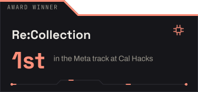</picture></a> 
<a href="https://shivin.me"><picture><source media="(prefers-color-scheme: light)" srcset="assets/light/card-all-projects.svg">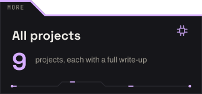</picture></a> 

 <picture><source media="(prefers-color-scheme: light)" srcset="assets/light/label-wins.svg"></picture> 
<picture><source media="(prefers-color-scheme: light)" srcset="assets/light/win-1.svg">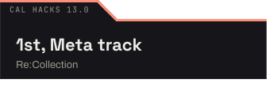</picture> 
<picture><source media="(prefers-color-scheme: light)" srcset="assets/light/win-2.svg">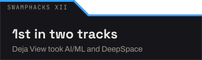</picture> 
<picture><source media="(prefers-color-scheme: light)" srcset="assets/light/win-3.svg">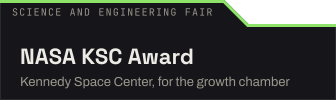</picture> 
<picture><source media="(prefers-color-scheme: light)" srcset="assets/light/win-4.svg">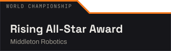</picture> 

 <picture><source media="(prefers-color-scheme: light)" srcset="assets/light/label-tools.svg">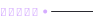</picture> 
<picture><source media="(prefers-color-scheme: light)" srcset="assets/light/tag-verilog.svg">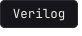</picture> 
<picture><source media="(prefers-color-scheme: light)" srcset="assets/light/tag-systemverilog.svg">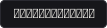</picture> 
<picture><source media="(prefers-color-scheme: light)" srcset="assets/light/tag-vivado.svg">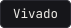</picture> 
<picture><source media="(prefers-color-scheme: light)" srcset="assets/light/tag-vitis.svg">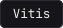</picture> 
<picture><source media="(prefers-color-scheme: light)" srcset="assets/light/tag-kicad.svg">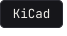</picture> 
<picture><source media="(prefers-color-scheme: light)" srcset="assets/light/tag-i2c.svg">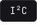</picture> 
<picture><source media="(prefers-color-scheme: light)" srcset="assets/light/tag-can-bus.svg"></picture> 
<picture><source media="(prefers-color-scheme: light)" srcset="assets/light/tag-cpp.svg">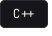</picture> 
<picture><source media="(prefers-color-scheme: light)" srcset="assets/light/tag-embedded-c.svg">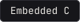</picture> 
<picture><source media="(prefers-color-scheme: light)" srcset="assets/light/tag-python.svg">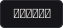</picture> 
<picture><source media="(prefers-color-scheme: light)" srcset="assets/light/tag-swift.svg">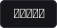</picture> 
<picture><source media="(prefers-color-scheme: light)" srcset="assets/light/tag-javascript.svg">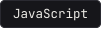</picture> 
<picture><source media="(prefers-color-scheme: light)" srcset="assets/light/tag-linux.svg">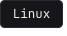</picture> 

  
<a href="https://shivin.me"><picture><source media="(prefers-color-scheme: light)" srcset="assets/light/btn-shivin-me.svg">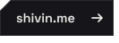</picture></a> 
<a href="https://shivin.me/hire.html"><picture><source media="(prefers-color-scheme: light)" srcset="assets/light/btn-the-30-second-version.svg">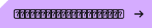</picture></a> 
<a href="https://shivin.me/ShivinAnandResume.pdf"><picture><source media="(prefers-color-scheme: light)" srcset="assets/light/btn-resume.svg"></picture></a> 
<a href="https://www.linkedin.com/in/shivinranand/"><picture><source media="(prefers-color-scheme: light)" srcset="assets/light/btn-linkedin.svg"></picture></a> 
<a href="mailto:shivin.r.anand@gmail.com"><picture><source media="(prefers-color-scheme: light)" srcset="assets/light/btn-email.svg">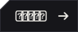</picture></a> 

